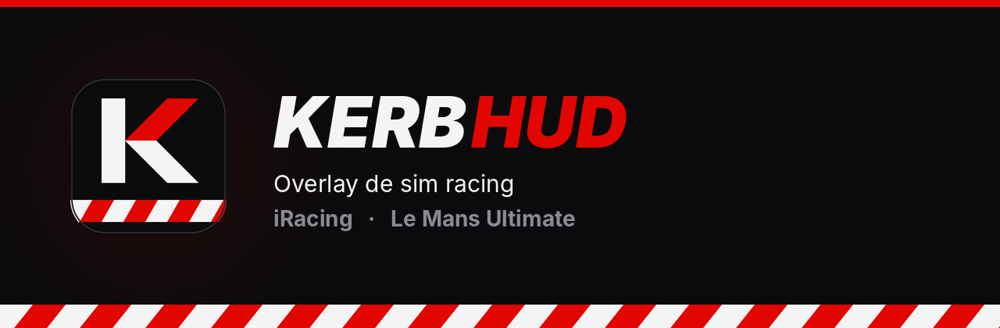
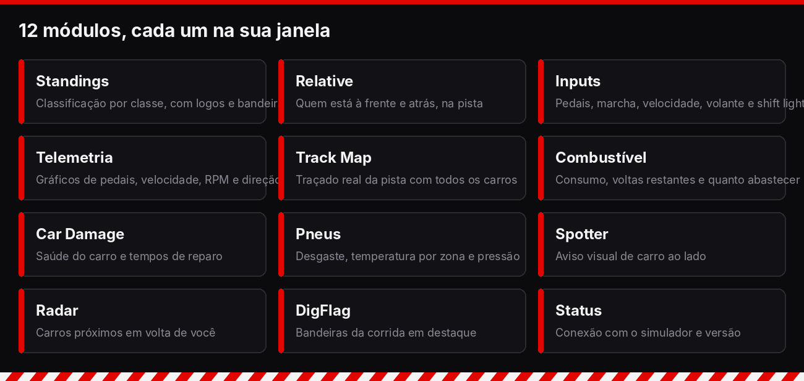
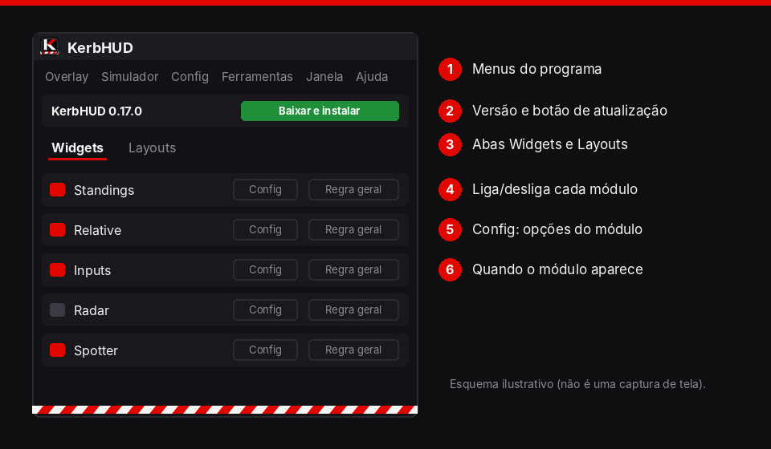
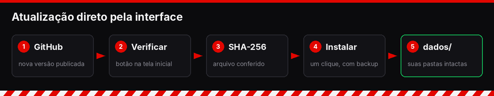
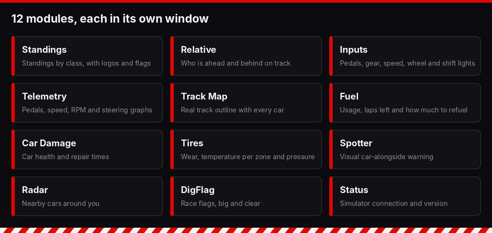
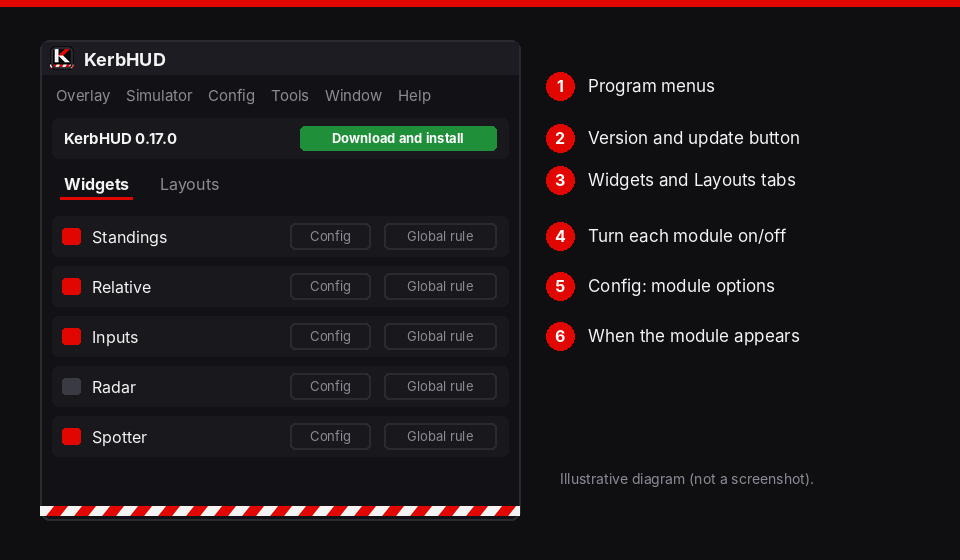
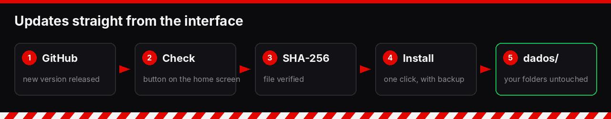
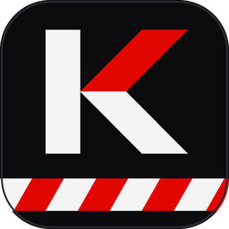

**[Português](#português)** · **[English](#english)**

---

## Português

**KerbHUD** é um overlay para **iRacing** e **Le Mans Ultimate**: classificação, relative, pedais, combustível, pneus, radar, bandeiras e mais, cada um numa janela transparente que você coloca onde quiser na tela. Ele só **lê** a telemetria que os simuladores publicam para aplicativos: sem injeção, sem mexer nos arquivos do jogo, sem enviar comandos.

O nome vem do **kerb**, a zebra vermelha e branca na beira da pista. *(Antes chamado SimOverlay.)*

### ✨ Destaques

- 🪟 **12 módulos, cada um na sua janela:** transparentes, sem borda, sempre no topo e click-through, então nunca atrapalham o jogo.
- 🎛️ **Janela principal simples:** liga/desliga cada módulo, ajusta as opções e escolhe quando ele aparece, tudo num lugar só. Fechar a janela minimiza para a bandeja.
- 📐 **Layouts:** move e redimensiona no modo de edição, salva quantos layouts quiser e troca por atalho, até no meio da corrida.
- 👁️ **Aparece só quando deve:** *Sempre*, *Só na pista* ou *Só na garagem*.
- 🖱️ **Barra de tarefas livre:** enquanto você usa a barra de tarefas, a bandeja ou um menu, o overlay sai da frente.
- 🔄 **Atualização com um clique:** o programa confere o GitHub, verifica o arquivo e instala. Suas logos, bandeiras e layouts nunca são tocados.
- 🧪 **Modo DEMO:** teste tudo sem abrir o jogo (bem sinalizado; dado real nunca é inventado).
- 🌎 **Português e inglês.**

### ⬇️ Baixar e instalar

1. Entre em **[Releases → mais recente](https://github.com/Alezin-web/KerbHUD/releases/latest)** e baixe o **`KerbHUD-windows.zip`**.
2. Extraia numa pasta à sua escolha (por exemplo `C:\Jogos\KerbHUD`). Não precisa de Python.
3. Abra o **`KerbHUD.exe`**. Na primeira vez um guia de boas-vindas mostra a interface e todos os atalhos.

> O **SmartScreen do Windows** pode dizer que "protegeu o computador" porque o `.exe` é novo e não tem assinatura digital. Clique em **Mais informações → Executar assim mesmo**. O checksum (`.sha256`) de cada arquivo fica publicado junto, no Release.

### 🏁 Primeiros passos

1. Abra o iRacing ou o Le Mans Ultimate; o KerbHUD detecta o jogo sozinho. Sem jogo aberto? Use **Simulador → DEMO**.
2. Aperte **`Ctrl+Alt+E`** para entrar no modo de edição e arrastar/redimensionar os módulos. Aperte de novo para travar.
3. Na aba **Widgets**, ligue/desligue os módulos e clique em **Config** para as opções de cada um.

| Atalho | Ação |
|---|---|
| `Ctrl+Alt+E` | Modo de edição (mover/redimensionar) |
| `Ctrl+Alt+H` | Mostrar/esconder o overlay |
| `Ctrl+Alt+←` / `→` | Layout anterior / próximo |
| `Ctrl+Alt+1` … `4` | Ir para o layout 1 … 4 |
| `Ctrl+Alt+N` | Próxima etapa do DEMO |

Todos os atalhos podem ser trocados em **Config → Configurações**.

### 🔄 Atualizações

Quando sai versão nova, aparece uma barra no topo da janela principal: clique em **Baixar e instalar**. Também dá para usar **Ajuda → Verificar atualizações**. O KerbHUD guarda uma cópia do que trocou em `.backup/`, e a pasta `dados` (suas logos, bandeiras, badges, layouts e pistas) **nunca** é alterada.

### 🛡️ Segurança

- **Somente leitura:** lê a memória compartilhada que o iRacing e o LMU publicam para apps de terceiros. Não injeta código, não altera arquivos do jogo e não envia comandos.
- **Atualizador cuidadoso:** só fala com o `github.com` por HTTPS, confere o SHA-256, recusa zips inseguros e guarda backup.
- **Código aberto:** tudo o que ele faz está neste repositório.

### 📁 Onde ficam as coisas

| Pasta | O que guarda |
|---|---|
| `dados\` (ao lado do `KerbHUD.exe`) | `logos`, `flags`, `badges`, `layouts`, `tracks`. São suas: atualizações nunca mexem aqui. |
| `%APPDATA%\KerbHUD\settings.json` | Suas configurações. |

Vindo do **SimOverlay**? Suas configurações e pastas de dados são **copiadas** sozinhas na primeira execução, e nada é apagado.

### ❓ Perguntas frequentes

**Funciona com outros simuladores?** Ainda não: só iRacing e Le Mans Ultimate. 
**Por que faltam logos ou países no LMU?** O LMU não informa fabricante, país nem rank para a maioria dos carros. O KerbHUD mostra o que o jogo fornece e nunca inventa dado. 
**No iRacing a posição só muda ao cruzar a linha?** Na corrida, não: o KerbHUD calcula a ordem pela posição de cada carro na pista, em tempo real (dá para voltar à posição oficial em Config → Configurações). No treino e na classificação a ordem é pela melhor volta, que só muda quando alguém completa uma volta. 
**Pesa no jogo?** A taxa de atualização é ajustável em **Config → Configurações** (dados e tela separados). 
**Achei um bug / tenho uma ideia.** Abra uma [issue](https://github.com/Alezin-web/KerbHUD/issues) com um print. O módulo **Status** mostra a versão que você está usando.

### ⚠️ Limitações conhecidas

Alguns nomes de variáveis do iRacing e parte do mapeamento de bandeiras/lados do LMU ainda precisam ser confirmados em corridas reais (marcados *VERIFICAR* no código). O radar do iRacing sabe a distância dos outros carros, mas não o lado exato ("lado estimado"). No iRacing o Track Map desenha o circuito a partir de **uma volta completa sua** (o jogo não publica a posição, então o caminho é calculado por velocidade e direção); se ele sair espelhado, use "Espelhar o traçado" nas opções do módulo. Retorno de corridas é muito bem-vindo.

<b>🛠️ Para desenvolvedores</b>

- Python 3.10+ (desenvolvido no 3.12) e `pip install -r requirements.txt` (PySide6).
- Rodar: `KerbHUD.bat`, `KerbHUD-DEMO.bat`, `KerbHUD-Editar.bat` ou `python -m kerbhud run | diag | snapshot | --version` (com `PYTHONPATH=src`).
- Testes: `python -m unittest discover -s tests`.
- **Regra do projeto:** toda novidade também aparece no DEMO (`DEMO_FEATURES` em `providers/demo.py`, conferido por `tests/test_demo_coverage.py`).
- Imagens da marca: `PYTHONPATH=src python tools/make_brand_assets.py`. Notas técnicas: [docs/NOTAS-TECNICAS.pt-BR.md](docs/NOTAS-TECNICAS.pt-BR.md).

---

## English

**KerbHUD** is an overlay for **iRacing** and **Le Mans Ultimate**: standings, relative, inputs, fuel, tires, radar, flags and more, each one in its own transparent window that you place anywhere on the screen. It only **reads** the telemetry the simulators publish for apps: no injection, no game-file changes, no inputs sent.

The name comes from the **kerb**, the red-and-white rumble strip at the edge of the track. *(Formerly named SimOverlay.)*

### ✨ Highlights

- 🪟 **12 modules, each in its own window:** transparent, borderless, always on top and click-through, so they never get in the way of the game.
- 🎛️ **Simple main window:** turn each module on/off, adjust its options and choose when it appears, all in one place. Closing it minimizes to the tray.
- 📐 **Layouts:** move and resize in edit mode, save as many layouts as you want and switch with a hotkey, even mid-race.
- 👁️ **Shows up only when it should:** *Always*, *On track only* or *In the garage only*.
- 🖱️ **Taskbar friendly:** while you use the taskbar, the tray or a menu, the overlay steps aside.
- 🔄 **One-click updates:** the program checks GitHub, verifies the file and installs it. Your logos, flags and layouts are never touched.
- 🧪 **DEMO mode:** try everything without opening the game (clearly marked; real data is never invented).
- 🌎 **Português and English.**

### ⬇️ Download and install

1. Go to **[Releases → latest](https://github.com/Alezin-web/KerbHUD/releases/latest)** and download **`KerbHUD-windows.zip`**.
2. Extract it to a folder of your choice (for example `C:\Games\KerbHUD`). No Python needed.
3. Open **`KerbHUD.exe`**. On the first run a welcome guide explains the interface and every hotkey.

> **Windows SmartScreen** may say it "protected your PC" because the `.exe` is new and not code-signed. Click **More info → Run anyway**. The checksum (`.sha256`) of each file is published next to it in the Release.

### 🏁 First steps

1. Start iRacing or Le Mans Ultimate; KerbHUD detects the game on its own. No game open? Use **Simulator → DEMO**.
2. Press **`Ctrl+Alt+E`** to enter edit mode and drag/resize the modules. Press it again to lock them.
3. In the **Widgets** tab, turn modules on/off and click **Config** for each module's options.

| Hotkey | Action |
|---|---|
| `Ctrl+Alt+E` | Edit mode (move/resize) |
| `Ctrl+Alt+H` | Show/hide the overlay |
| `Ctrl+Alt+←` / `→` | Previous / next layout |
| `Ctrl+Alt+1` … `4` | Go to layout 1 … 4 |
| `Ctrl+Alt+N` | Next DEMO stage |

All hotkeys can be changed in **Config → Settings**.

### 🔄 Updates

When a new version comes out, a bar appears at the top of the main window: click **Download and install**. You can also use **Help → Check for updates**. KerbHUD keeps a copy of what it replaced in `.backup/`, and the `dados` folder (your logos, flags, badges, layouts and tracks) is **never** changed.

### 🛡️ Safety

- **Read-only:** reads the shared memory that iRacing and LMU publish for third-party apps. It does not inject code, modify game files or send inputs.
- **Careful updater:** only talks to `github.com` over HTTPS, checks SHA-256, refuses unsafe zip files and keeps a backup.
- **Open source:** everything it does is in this repository.

### 📁 Where things live

| Folder | What it holds |
|---|---|
| `dados\` (next to `KerbHUD.exe`) | `logos`, `flags`, `badges`, `layouts`, `tracks`. Yours: updates never touch it. |
| `%APPDATA%\KerbHUD\settings.json` | Your settings. |

Coming from **SimOverlay**? Your settings and data folders are **copied** automatically on the first run, and nothing is deleted.

### ❓ FAQ

**Does it work with other simulators?** Not yet: only iRacing and Le Mans Ultimate. 
**Why are some logos or countries missing in LMU?** LMU doesn't publish the manufacturer, country or rank for most cars. KerbHUD shows what the game provides and never makes data up. 
**On iRacing, does the position only change when crossing the line?** Not in a race: KerbHUD works out the order from each car's position on track, in real time (you can go back to the official position in Config → Settings). In practice and qualifying the order is by best lap, which only changes when someone completes a lap. 
**Does it slow the game down?** The refresh rate is adjustable in **Config → Settings** (data and screen separately). 
**I found a bug / have an idea.** Open an [issue](https://github.com/Alezin-web/KerbHUD/issues) with a screenshot. The **Status** module shows the version you are using.

### ⚠️ Known limits

Some iRacing variable names and some LMU flag/side mappings still need confirmation in real races (marked *VERIFY* in the code). The iRacing radar knows the distance to other cars but not the exact side ("estimated side"). On iRacing the Track Map draws the circuit from **one full lap of yours** (the game does not publish the position, so the path is computed from speed and heading); if it comes out mirrored, use "Mirror the track outline" in the module options. Feedback from races is welcome.

<b>🛠️ For developers</b>

- Python 3.10+ (developed on 3.12) and `pip install -r requirements.txt` (PySide6).
- Run: `KerbHUD.bat`, `KerbHUD-DEMO.bat`, `KerbHUD-Editar.bat` or `python -m kerbhud run | diag | snapshot | --version` (with `PYTHONPATH=src`).
- Tests: `python -m unittest discover -s tests`.
- **Project rule:** every new feature also appears in the DEMO (`DEMO_FEATURES` in `providers/demo.py`, checked by `tests/test_demo_coverage.py`).
- Brand images: `PYTHONPATH=src python tools/make_brand_assets.py`. Technical notes: [docs/NOTAS-TECNICAS.pt-BR.md](docs/NOTAS-TECNICAS.pt-BR.md).

---

 
Projeto independente, sem vínculo com iRacing ou Le Mans Ultimate. · KerbHUD is an independent project, not affiliated with iRacing or Le Mans Ultimate.

